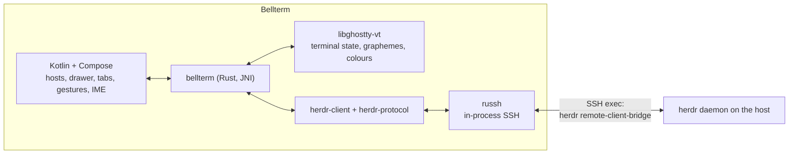

# Bellterm

Bellterm is a native Android client for a [Herdr](https://herdr.dev/) daemon
running on a machine you reach over SSH. The name is the terminal's bell (BEL)
and the bellwether that leads a herd: it rings when an agent needs you. It is a client only: Herdr on
the host owns the terminals, workspaces, tabs, panes, and agents, and they keep
running when the phone disconnects, sleeps, or loses signal.

> **Unaffiliated project.** Bellterm works with Herdr but is not affiliated
> with, endorsed by, or supported by Herdr or herdr.dev.

Bellterm runs on Android 10 (API 29) or newer, on arm64 and x86_64. The
terminal library's Zig code uses ELF thread-local storage, which Android's
loader only supports from Android 10.

## What it does

| Herdr concept | In Bellterm |
| --- | --- |
| Host and session | **Nodes** on the start screen, grouped and searchable, each with a colour label; tap one to attach. A node's group is typed, picked from the groups in use, or left blank in the node editor. Each node names a Herdr session (`default` unless you use named sessions). |
| Workspaces | The navigation drawer (☰), with branch, ahead/behind, linked worktree, and the daemon's status dot. **New workspace** at the bottom. The drawer lists workspaces and agents; tabs are switched from the tab row. |
| Tabs | The tab row under the top bar, with each tab's status dot; **+** opens a new tab, named as you type it or numbered by Herdr when left blank. |
| Panes | Drawn as Herdr lays them out. Tap a pane to focus it; split, zoom, and close from the ⋮ menu. |
| Agents | Listed in the drawer with **Working / Needs input / Done / Idle**; tap one to jump to its pane. When the app is in the background, the daemon's own "needs input" and "finished" notifications become Android notifications. |

### Reaching hosts

- **Jump hosts.** A node can name another node as its jump host, which can have
  its own, as `ssh -J a,b host` does. Every hop's host key is checked and
  trusted separately; the trust prompt names the hop.
- **Keys and certificates.** **Keys & certificates** (the lock icon) holds the
  device key generated on the phone, generated keys, and imported OpenSSH
  private keys (RSA, ECDSA, Ed25519; a passphrase is used once to decrypt).
  Private keys are stored encrypted with an AES-GCM key held by the Android
  Keystore. Attach an OpenSSH user certificate (`*-cert.pub`) to a key for
  hosts that trust a CA (`TrustedUserCAKeys`); Bellterm checks that it
  certifies the key and shows its principals and validity.
- **Passwords** can be saved per node, in the node editor or with **Remember
  password** when asked, encrypted like private keys with the Android
  Keystore's AES-GCM key; a hop without a saved password is asked for one on
  each connection. **Forget saved password** in the node editor, switching the
  node to key sign-in, or deleting the node removes it. When a host rejects a
  saved password, the session offers **Enter password** for that hop, and the
  new password replaces the saved one. Hosts that ask through
  keyboard-interactive get the same password.
- **SSH config import.** Paste or choose your `~/.ssh/config`: every `Host`
  alias becomes a node, `HostName`/`User`/`Port`/`ServerAliveInterval` are
  applied with OpenSSH's first-value-wins rules (wildcard and negated `Host`
  patterns included), and `ProxyJump` chains become jump-host nodes. `Match`
  and `Include` are reported, not applied; keys named by `IdentityFile` are
  imported separately.
- **Known hosts** lists trusted fingerprints by `host:port`; forgetting one
  re-prompts on the next connection. A changed key is refused with a warning.
- **Keepalive** per node keeps mobile connections from idling out.

### Appearance

- Bellterm's own brass-and-slate Material 3 theme in light and dark, or
  Material You wallpaper colours; light/dark follows the system or is fixed.
- English and Simplified Chinese. **Settings > Language** follows the system by
  default (any Chinese system locale gets Chinese) or pins one; on Android 13
  and later the choice is the system's per-app language, also under the app's
  entry in system settings.
- Terminal colour schemes for dark and light separately: Bellterm, Catppuccin
  Mocha/Latte, Dracula, GitHub Light, Gruvbox, Nord, One Dark, Solarized,
  Tokyo Night. The scheme also becomes the host theme Herdr reports to pane
  programs.
- **Fonts with Nerd Font icons.** JetBrains Mono Nerd Font Mono ships in the
  app; Fira Code, Cascadia Code, Source Code Pro, and Ubuntu Mono download
  in-app from the nerd-fonts v3.5.1 release, each file checked against a
  pinned size and SHA-256. Any TTF/OTF can be imported, and
  the system monospace face is offered too; for fonts without Nerd Font icons,
  the bundled Symbols Nerd Font draws them.

Android conventions it follows:

- **Back** closes the drawer, then returns to the node list without detaching.
  A foreground-service notification shows the attachment, with **Disconnect**.
- The soft keyboard types straight into the focused pane: no suggestions or
  autocorrect, and CJK input methods compose in place at the cursor.
- An extra-keys row sits above the keyboard: Esc, Tab, latching **Ctrl** and
  **Alt** for the next key, arrows and paging keys that repeat while held, and
  symbols phone keyboards hide.
- Drag or fling to scroll a pane, pinch to change the font size, long-press to
  select text with the system **Copy / Paste** toolbar. The bell can vibrate,
  and the screen can stay on during a session.
- Hardware keyboards work, including Ctrl and Alt chords.

Closing a pane, tab, or workspace asks first, because Herdr ends the programs
in it.

## Signing in

On first launch Bellterm generates an Ed25519 key on the device. Add its public
key (Keys & certificates → Copy public key) to the host:

```sh
echo 'ssh-ed25519 AAAA… bellterm@Pixel7' >> ~/.ssh/authorized_keys
```

or sign it with your SSH CA and attach the certificate. The first connection to
each hop shows the host key's SHA-256 fingerprint for you to compare with
`ssh-keygen -lf /etc/ssh/ssh_host_ed25519_key.pub` on that host before trusting
it.

The host that runs Herdr needs `/bin/sh` and Herdr 0.9.0 or later in one of the
the usual install locations (for example `~/.local/bin/herdr`).
Nothing is installed, started, or upgraded on the host: if no Herdr server is
running for the session, start one there with `herdr`. Jump hosts need only
SSH with TCP forwarding allowed.

## How it works



- **Transport.** Android has no `ssh` executable, so the core uses
  [russh](https://crates.io/crates/russh) on a thread of its own. It runs the
  same remote bridge discovery script a desktop client runs through `ssh`, and
  answers it with `herdr_client::answer_remote_bridge`; the channel is pumped
  through a Unix socket pair into herdr-client's ordinary worker.
- **Terminal.** Herdr sends rendered cell grids, not a byte stream. Each
  surface is written into a [libghostty-vt](https://github.com/ghostty-org/ghostty)
  terminal as VT (changed rows only, with control characters stripped from
  cell symbols), and frames are read back from its render state: grapheme
  clusters, wide characters, colour resolution through the theme palette, and
  the cursor all come from Ghostty. The view draws those frames on a Canvas.
- **Threads.** The Rust core owns every blocking operation. A screen thread
  owns libghostty (whose types are not `Send`) and publishes only the latest
  frame and shell view, so a slow view never queues stale frames. The Kotlin
  side pulls events on a background thread; the UI thread never blocks.

| Path | Responsibility |
| --- | --- |
| `native/src/ssh/` | Routes through jump hosts, host key pinning, key/certificate/password auth, bridge pump |
| `native/src/config.rs` | The route document Kotlin sends, parsed into zeroizing types |
| `native/src/keys.rs` | Key generation and import, certificate inspection |
| `native/src/ssh_config.rs` | OpenSSH client configuration import |
| `native/src/vt.rs` | Herdr cells (and popups) as VT for libghostty |
| `native/src/screen.rs`, `render.rs` | libghostty terminal; frames packed for Kotlin |
| `native/src/session.rs` | Connection, event mailboxes, input routing |
| `native/src/input.rs` | Android key codes and touches as Herdr semantic input |
| `native/src/jni_api.rs` | `app.bellterm.core.Native` |
| `app/src/main/java/…/core` | JNI wrapper, frame and shell-view parsing, `Connection` |
| `app/src/main/java/…/ui` | Compose screens and the `TerminalView` |
| `crates/herdr-client`, `crates/herdr-protocol` | Herdr's wire protocol and client worker (Apache-2.0, see `NOTICE`) |

## Building

Requirements: JDK 17, the Android SDK (platform 35) and NDK 27.2.12479018,
Rust with the `aarch64-linux-android` and `x86_64-linux-android` targets,
[cargo-ndk](https://github.com/bbqsrc/cargo-ndk), and **Zig 0.15.2**, which
`libghostty-vt-sys` uses to build Ghostty (the pinned Ghostty commit requires
exactly that version).

```sh
rustup target add aarch64-linux-android x86_64-linux-android
cargo install cargo-ndk --locked
# local.properties (not committed):
#   sdk.dir=/path/to/Android/Sdk
#   zig.dir=/path/to/zig-0.15.2
just build      # app/build/outputs/apk/debug/app-debug.apk (Bellterm)
just test       # Rust core tests on the host, then Kotlin unit tests
```

Gradle runs cargo-ndk before every build. If Zig cannot fetch Ghostty's
dependencies (it uses its own resolver), prefetch them into the Zig cache with
`zig fetch <url>` on each URL it reports.

The release build is minified. To sign it with your own key, point the build
at a keystore through environment variables (or Gradle properties of the same
names, such as in `~/.gradle/gradle.properties`); without them it is signed
with the debug key:

```sh
keytool -genkeypair -keystore bellterm-release.jks -alias bellterm \
  -keyalg RSA -keysize 4096 -validity 10000
export BELLTERM_KEYSTORE=/path/to/bellterm-release.jks
export BELLTERM_KEYSTORE_PASSWORD=…   # BELLTERM_KEY_PASSWORD too, if it differs
export BELLTERM_KEY_ALIAS=bellterm
./gradlew assembleRelease           # app/build/outputs/apk/release/app-release.apk
```

Keep the keystore and its passwords out of the repository: every later update
must be signed with the same key, or Android refuses to install it over the
existing app.

### Publishing an update

The app checks `https://dl.bellterm.app/latest.json` at most once a day, and
whenever *Check for updates* is tapped in Settings. When it lists a higher
`versionCode`, the node list offers the release; *Download* opens its APK in
the browser. To publish one:

1. Raise `versionCode` and `versionName` in `app/build.gradle.kts`; optionally
   write release notes to `release-notes/<versionName>.en.txt` and `.zh.txt`.
2. Push the tag `v<versionName>`. The Release workflow builds the APK with the
   release key (from the `BELLTERM_*` repository secrets, the keystore
   base64-encoded as `BELLTERM_KEYSTORE_BASE64`), writes `latest.json`, and
   attaches both to a GitHub release.
3. Upload `bellterm-<versionName>.apk` and then `latest.json` to
   `https://dl.bellterm.app/`, in that order, so the manifest never points at
   a missing file.

To do it locally instead, build with the release key and run
`scripts/release-manifest.sh app/build/outputs/apk/release/app-release.apk dist`.
The script refuses an APK signed with the debug key.

### Live test

`native/tests/live_ssh.rs` connects over real SSH to a real daemon: it checks
the host key prompt, attaches, reads a frame back through libghostty, types a
command, and sees its output. It types into the focused pane, so point it only
at a throwaway daemon:

```sh
cd native
cargo run --example keygen -- /tmp/bellterm-key   # prints the public key
BELLTERM_LIVE_HOST=127.0.0.1 BELLTERM_LIVE_PORT=2222 \
BELLTERM_LIVE_USER=$USER BELLTERM_LIVE_KEY=/tmp/bellterm-key \
  cargo test --test live_ssh -- --ignored --nocapture
```

Set `BELLTERM_LIVE_JUMP_PORT` to reach the target through a jump host on the
same address, and `BELLTERM_LIVE_CERT` to a certificate for the key to sign in
with it (point the target's `TrustedUserCAKeys` at the CA and its
`AuthorizedKeysFile` at `none` to prove the certificate is what is used).

## Limitations

- Inline images (Kitty graphics, Sixel) are not drawn yet.
- Hosts that only offer PowerShell (Windows OpenSSH) are not supported.
- Generated keys are Ed25519; RSA and ECDSA keys can be imported but not
  generated. FIDO/security-key (`sk-`) keys and SSH agents are not supported.
- `Match` and `Include` in imported SSH configuration are not evaluated.

## License

Bellterm is released under the [Apache License 2.0](LICENSE). The Herdr
protocol and client crates in `crates/` are third-party code under the same
licence with their own copyright, and the bundled fonts keep their own
licences; [NOTICE](NOTICE) lists each of them.
